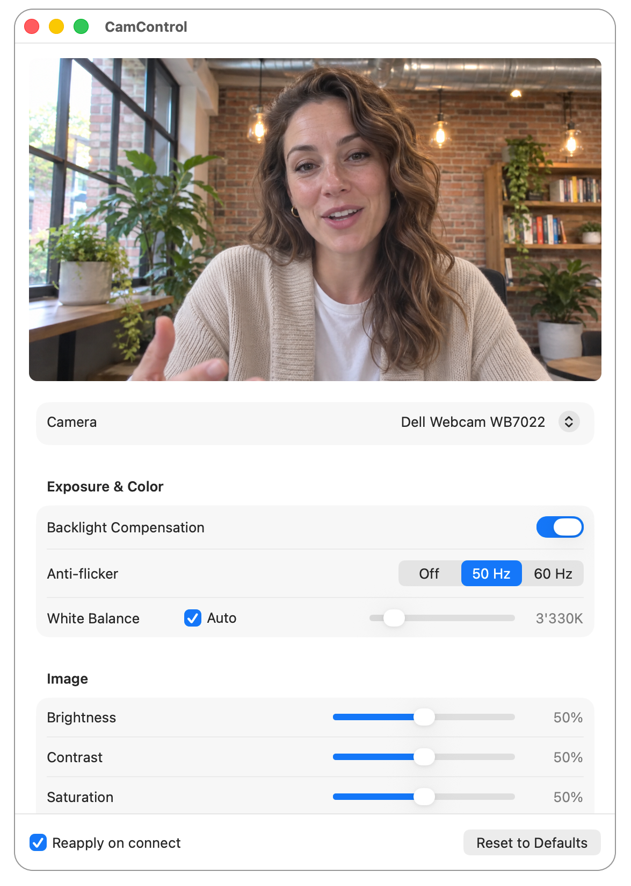

# CamControl

A macOS menu bar utility that adjusts USB webcam settings (exposure, gain, brightness, contrast,
white balance, zoom, pan/tilt, …) with a live preview, and reapplies them automatically whenever the camera is
plugged in again.



## Features

- **Live preview** of the selected camera, so the effect of every change is visible immediately.
- **Camera picker** for when several cameras are connected.
- **Camera settings**: all settings the camera supports are shown and adjustable.
- **Reapply on connect**: per camera, the current settings are saved and written back every time
  the camera is plugged in, even while the app has no window open.
- **Reset to Defaults** restores the camera's built-in settings.
- **Runs in the menu bar**: closing the window keeps the app running in the background, without a
  Dock icon.
- **Launch at login** (optional, in Settings) so saved settings are reapplied after a restart.
- English and German.

## Download

CamControl requires macOS 15 Sequoia or later.

Download the signed and notarized DMG from the
[latest release](https://github.com/manuelbl/CamControl/releases/latest), open it and drag
CamControl to the Applications folder.

Or install it with [Homebrew](https://brew.sh):

```bash
brew install --cask manuelbl/tap/camcontrol
```

## Limitations

- Only USB cameras can be adjusted. Other cameras, such as the MacBook's
  built-in camera or Continuity Camera, show the live preview but no settings. USB cameras must support the USB Video Class (UVC), which all do with very few exceptions.
- Which settings are available depends on the camera; unsupported ones are hidden.
- Settings are saved per camera model and serial number. Two identical cameras without a unique
  serial number share one saved profile.
- Settings are only reapplied while CamControl is running. Enable *Launch at login* to make sure
  it always is.

## Building

Prerequisites:

- Xcode 26 or later (the app icon is an Icon Composer `.icon` file)
- [XcodeGen](https://github.com/yonaskolb/XcodeGen), which generates the Xcode project from
  `project.yml`:

  ```bash
  brew install xcodegen
  ```

Clone the repository and generate the project:

```bash
git clone https://github.com/manuelbl/CamControl.git
cd CamControl
xcodegen generate
```

### In Xcode

Open `CamControl.xcodeproj`, select the *CamControl* target, choose your own team under
*Signing & Capabilities*, and run the *CamControl* scheme.

### From the command line

To build without an Apple developer account, sign the app ad hoc:

```bash
xcodebuild -project CamControl.xcodeproj -scheme CamControl -configuration Release \
    -derivedDataPath build/adhoc \
    CODE_SIGN_IDENTITY=- DEVELOPMENT_TEAM= CODE_SIGN_STYLE=Manual build
```

The app is created at `build/adhoc/Build/Products/Release/CamControl.app`. An ad-hoc signed app
runs on the Mac it was built on but can't be distributed.

### Tests

```bash
xcodebuild test -project CamControl.xcodeproj -scheme CamControlTests -destination 'platform=macOS'
```

The tests need no camera hardware.

## Documentation

- [docs/spec.md](docs/spec.md): what the app does and the design decisions behind it
- [CONTEXT.md](CONTEXT.md): glossary of the domain terms used in code and docs
- [docs/adr/](docs/adr/): architecture decision records
- [RELEASING.md](RELEASING.md): building a signed, notarized DMG

## License

[MIT](LICENSE)
